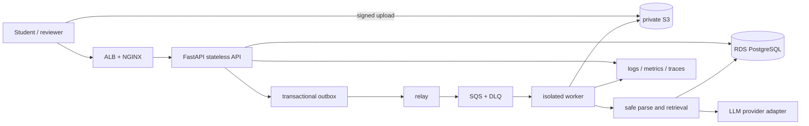
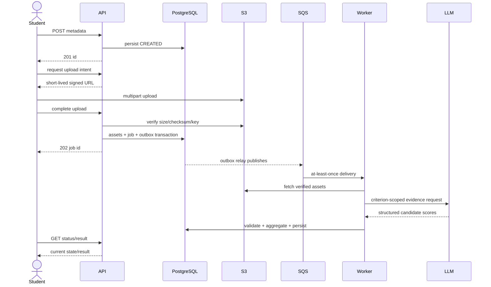

# Design an AI-Powered Project Evaluation Platform

**AlmaBetter SDE-II Backend Architecture Assignment**  
Architecture and offline proof-of-concept | 13 October 2026

## 1. Executive summary

The platform accepts student project metadata and large project assets, then evaluates asynchronously against a versioned, configurable rubric. At the initial 30 submissions/day, a modular FastAPI service, managed PostgreSQL, private S3, SQS, and a small independently deployed worker fleet is sufficient. At 10,000/day, retain the same domain boundaries and durable workflow while scaling stateless APIs and queue workers horizontally, applying admission control, provider quotas, tenant fairness, and measured database tuning. The design avoids synchronous long-running HTTP requests and treats submitted content and model output as untrusted.

The included PoC implements metadata submission, rubric creation/listing, idempotent evaluation enqueue, status/result retrieval, a mock evaluator, weighted scoring, basic review, request IDs, health checks, SQLAlchemy persistence, and a local polling worker. It uses SQLite and in-process work for an offline demonstration. It does not implement auth, uploads, AWS adapters, durable queue/outbox, parser sandboxing, or a live LLM. No deployment is claimed.

## 2. Requirements, assumptions, and boundaries

Assume 30/day growing to 10,000/day; 100 MB average, occasional >1 GB; evaluation 2–15 minutes; multiple provider calls; failures and human review. Browser clients authenticate through institutional OIDC in production. Assignment/course enrollment and rubric ownership are authoritative. Student files are hostile. Feedback is retained under course policy and can be deleted subject to legal/audit requirements. Local environment inspected: Windows PowerShell, Python 3.13.2, Node 22.14, Git available; Docker unavailable. The PoC is runnable without credentials or paid APIs.

## 3. Architecture and component rationale

The API owns authentication, authorization, validation, metadata, idempotency, and short transactions. ALB terminates external traffic and distributes requests; NGINX can provide ingress policy, request limits, and consistent headers where operationally useful. PostgreSQL is the system of record for relationships, constraints, audit references, and job state. S3 stores large immutable asset bytes, avoiding database bloat. SQS decouples acceptance from expensive work. The relay closes the database/queue dual-write gap through the outbox. Workers perform scanning, extraction, retrieval, provider calls, validation, scoring, and result writes with least privilege. A provider interface contains vendor details. Human reviewers close ambiguous cases. CloudWatch/OpenTelemetry-compatible logs, metrics, traces, dashboards, and alarms support operations.

Initially these can be a modular API, managed PostgreSQL, S3, SQS, one worker service, and basic alerting. At target scale, add API/worker autoscaling, queue-age-based capacity policies, separate parsing/provider concurrency pools, quotas, tenant fairness, and richer telemetry. Split deployables only where independent scaling/isolation justifies it.

## 4. Submission lifecycle and state

Metadata create and upload intent are synchronous, bounded operations. Upload bytes go directly to object storage. Completion validates object ownership/key, length, checksum, and scan result; only then is an evaluation job accepted. Job creation and outbox insertion share one DB commit; a relay retries publication. Worker stages persist events and attempt details. Parse and LLM stages have per-stage deadlines and bounded retries. Result retrieval is read-only and returns 409 while unavailable. The explicit transition graph is in `docs/architecture/diagrams/failure-recovery.mmd`; transitions use conditional updates and append-only audit events. Retries use capped exponential backoff with jitter. SQS visibility timeout is extended from heartbeats for long tasks; acknowledge only after result commit. Expired leases are reaped, and poison jobs move to a DLQ for operator inspection/replay. The PoC's in-process worker is volatile and lacks lease recovery.

## 5. API design

Versioned REST endpoints and production-only upload contracts are enumerated in `docs/api/api-specification.md`. Key semantic distinction: creating a submission is `POST /api/v1/submissions` (201); explicitly starting evaluation is `POST /api/v1/submissions/{id}/evaluations` (202) with an idempotency key. Status uses `GET /api/v1/evaluations/{id}`; result uses `GET /api/v1/submissions/{id}/result`. Rubrics use GET/POST `/api/v1/rubrics`; human decision uses POST `/api/v1/evaluations/{id}/reviews`. Health/readiness are `/health/live` and `/health/ready`.

The PoC's actual OpenAPI is generated at `/openapi.json`. Create request: `{"student_id":"student-1","course_id":"course-1","assignment_id":"assignment-1","title":"Inventory API","content":"Project evidence..."}`. Evaluation request: `{"idempotency_key":"client-unique-001"}`. Job response: `{"id":"…","submission_id":"…","status":"QUEUED","attempt":0,"score":null}`. Errors are `{ "error": {"code":"http_error","message":"...","request_id":"..."}}`. Production should add OAuth scopes/role checks, tenant filtering, cursor pagination at high volume, request limits, consistent domain error codes, and Idempotency-Key request-hash conflict detection.

## 6. Data model

The relational ER diagram is `docs/architecture/diagrams/database-er.mmd`; production DDL is `docs/database/schema.sql`. Users belong to tenants; courses contain assignments; assignments receive submissions. Submissions reference immutable asset metadata. A job snapshots one rubric version and evaluator/prompt/model versions. Attempts record each execution; one immutable result has criterion-level scores, evidence pointers, confidence, and provenance. Reviews and append-only events preserve audit history. Unique `(submission_id,idempotency_key)` prevents duplicate requests; object keys and `(rubric_id,version)`, `(result_id,criterion_key)` are unique. Index status/created time for workers and assignment/time for course listings. Tenant IDs must participate in authorization predicates; PostgreSQL RLS is a possible defense-in-depth layer after connection pooling/session context is designed. Soft deletion plus lifecycle expiry applies to assets and PII; audit records can be minimized/pseudonymized.

Weights must be positive and sum exactly to 100 at rubric publication; criterion keys are unique. Default example weights are Functionality 25%, Code Quality 20%, Architecture 20%, Problem Solving 15%, Documentation 10%, Innovation/AI Usage 10%. These are seed data, never hard-coded scoring branches. Preserve published rubric versions; edits create a new version.

## 7. AI evaluation and project understanding

Build a manifest of files, checksums, type, size, and parse status. Exclude binaries, generated/vendor trees, secrets, and irrelevant huge files using explicit policy. Parse language-aware structure in a restricted worker, chunk by symbol/function with paths and line spans, and retain hashes. Retrieve criterion-specific evidence using lexical search initially; add embeddings/pgvector when recall evaluation demonstrates value. Project overview and architecture summaries precede per-criterion analysis. Keep context within provider token limits using ranked evidence, deduplication, summaries linked to source spans, and capped chunks.

Prompt instructions and submitted text are separated; student content is quoted untrusted evidence, tools are disabled, and model answers must match a strict schema and cite supplied evidence references. Provider output never sets the final overall score. Deterministic aggregation computes `sum(score_i × weight_i / 100)` after validating 0–100 criterion bounds, required criteria, confidence, and evidence. Store prompt hash, provider/model, token/cost metadata where available, evaluator version, asset hashes, and retrieval provenance. Missing evidence, low confidence, contradictions, suspicious score patterns, and policy triggers route to human review. Benchmark and calibrate against labeled examples, measure agreement and drift, and gate model/prompt changes. A hosted LLM may transmit student work: minimize data, review terms/retention controls and institutional policy, and make provider selection configurable. No live LLM is implemented.

## 8. Reliability and failure handling

The transactional outbox ensures a committed job is eventually publishable; delivery remains at-least-once, so workers are idempotent. Every stage has timeout, heartbeat, bounded concurrency, retry classification, attempt record, and durable status boundary. Network errors, throttles, and provider 5xx are retryable; malformed archives, policy violations, and exhausted schema failures are terminal or human-review cases. DLQ alarms include job age and error code; replay requires operator visibility and idempotent writes. Backpressure responds to queue age, provider quota, and storage pressure; return 429/503 before accepting work if capacity budget is exhausted. Graceful shutdown stops claiming new work and finishes or releases leases.

## 9. Security and privacy

Threats include archive traversal/bombs, parser exploits, malicious source, SSRF through repository URLs, prompt injection, cross-tenant leakage, secrets in source, provider data exposure, and abusive submission floods. Detailed controls are in `docs/security/security-design.md`. In brief: OIDC and scoped RBAC, short-lived per-key upload URLs, checksum/size validation, malware scanning/quarantine, private encrypted object storage, bounded parser workers with no credentials or network, and no code execution in API/privileged workers. URL acquisition rejects private/loopback/link-local/metadata IPs after each redirect and resolution, with connect-time validation and network-level egress restrictions against DNS rebinding. Use parameterized SQL, output encoding, CSRF protection for cookie auth, rate limits, audit history, KMS and TLS. Minimize PII, retention, and third-party data. Authentication is not implemented in PoC.

## 10. Scaling model: 30 to 10,000 per day

Assuming uniform arrival across 24h, 30/day = 1.25/hour = 0.000347 submissions/s. At 10,000/day = 416.7/hour = 0.1157/s. These are averages, not peak rates; a 10× peak factor yields 1.16/s. Little's Law with average processing 8.5 minutes gives about 0.007 concurrent jobs initially, 59 concurrent at target average arrival, and ~590 at the assumed peak arrival if queue delay is to remain negligible. This concurrency is a capacity planning upper target, not a benchmark; practical target concurrency must include utilization headroom, provider quotas, retries, and latency SLO. At 100 MB average, raw ingress is about 3 GB/day initially and 1 TB/day at target; 1 GB outliers require multipart uploads and explicit per-assignment caps. Storage retention multiplies daily ingress by retention duration and replica/version policy.

At 30/day, keep one relational DB, S3, SQS, and modest worker capacity; accept queueing during bursts. At scale, autoscale workers on oldest-message age and backlog-per-worker, cap by provider RPM/TPM and budget, prioritize fair per-course scheduling, separate parsing and model-call semaphores, and apply admission control. Scale stateless API tasks behind ALB. Pool database connections through RDS Proxy/appropriate pooling; inspect query plans and queue indexes before partitioning. Use S3 lifecycle and multipart transfer. Cache immutable rubric versions and provider metadata, not private evaluation results across tenants. Add read replicas only for measured read pressure; sharding/Kafka/Kubernetes/multiple stores are not baseline recommendations. ECS workers can autoscale on SQS backlog using AWS documented controls. Multi-AZ DB and backups are initial production resilience; regional recovery depends on RPO/RTO and cost objectives.

## 11. Deployment and operations

Production target: Route 53/TLS → ALB → optional NGINX ingress → stateless ECS API tasks; private RDS PostgreSQL; private S3 with endpoint; SQS and DLQ; outbox relay; ECS worker tasks in private subnets. Use task IAM roles, Secrets Manager, security groups, CloudWatch alarms/logs, OpenTelemetry traces, and GitHub Actions build/test/publish/deploy. Migrations run as a controlled one-off job using expand/contract changes. Health endpoints separate liveness/readiness. Deploy rolling/canary with health gates and rollback; test restores and define RPO/RTO. A minimal Dockerfile, local Compose file, NGINX sample, and CI test workflow are included, but Docker is unavailable here so these have not been executed; Compose is a single-process SQLite demo, not the production topology. No AWS resources were created.

## 12. Technology decisions and research

| Decision | Selected and why | Alternatives / tradeoffs | Evidence |
|---|---|---|---|
| Relational store | PostgreSQL for transactional workflow, constraints, history, JSONB flexibility; managed RDS operationally appropriate | MongoDB can work for document-centric workloads and supports transactions, but this domain has strong cross-entity constraints | [PostgreSQL transactions](https://www.postgresql.org/docs/current/tutorial-transactions.html), [MongoDB transactions](https://www.mongodb.com/docs/manual/core/transactions/) |
| Queue | SQS for managed durable delivery, visibility timeout and DLQ fit; less broker operations | RabbitMQ gives routing/control, Kafka suits replayable high-throughput event streams but raises ops and is not needed by current load | [SQS visibility](https://docs.aws.amazon.com/AWSSimpleQueueService/latest/SQSDeveloperGuide/working-with-visibility-timeouts.html), [recovery/DLQ](https://docs.aws.amazon.com/AWSSimpleQueueService/latest/SQSDeveloperGuide/designing-for-outage-recovery-scenarios.html) |
| API | FastAPI/Pydantic for typed validation and generated OpenAPI in Python ecosystem | Django REST offers integrated admin/auth; Node frameworks suit JS teams. Keep app modular; framework alone is not scale strategy | [FastAPI async](https://fastapi.tiangolo.com/async/) |
| Object storage | S3 for large objects, direct signed transfer, multipart uploads, lifecycle | DB blobs are unsuitable; self-hosted compatible stores transfer ops to team | [S3 signed upload](https://docs.aws.amazon.com/AmazonS3/latest/userguide/PresignedUrlUploadObject.html), [multipart](https://docs.aws.amazon.com/AmazonS3/latest/userguide/mpuoverview.html) |
| Vector retrieval | Start lexical; pgvector when embeddings needed so metadata and vectors share Postgres | Pinecone/Weaviate may help at independent vector scale or managed-specialist needs, with added service and data synchronization | [pgvector capabilities/tradeoffs](https://github.com/pgvector/pgvector) |
| Compute | ECS for independently scalable API/worker tasks and managed scheduling | EC2 gives control but more patching; Lambda can fit short event work but 2–15 minute variable jobs, large payload staging, and sandboxing favor worker tasks | [ECS services](https://docs.aws.amazon.com/AmazonECS/latest/developerguide/ecs_services.html), [queue-based scaling](https://docs.aws.amazon.com/AmazonECS/latest/developerguide/service-autoscaling-queue.html) |
| LLM | Hosted API behind adapter initially for model quality/low ops, subject to contractual privacy review | Self-host when predictable high sustained use, data control, or economics justify GPU operations and quality can be maintained | [OpenAI API data controls](https://platform.openai.com/docs/guides/your-data) |

Facts above are limited to linked documentation; selection and workload fit are engineering judgment. No current pricing/quotas are stated because they are account, region, model, and date dependent. For provider and vector alternatives, run a representative benchmark and privacy review before selection.

## 13. Roadmap

1. Core lifecycle and identity: submission/course authorization, metadata, migrations, rubric versions; accept only valid owned assignments.
2. Durable orchestration: outbox, SQS/DLQ, leases, retry/reaper; prove duplicate delivery safety and crash recovery.
3. Secure ingestion: signed multipart uploads, checksums, scanning, extraction quotas; hostile corpus test acceptance.
4. Rubric evaluation: provider adapters, evidence schema, deterministic score, offline benchmark; quality and cost gates.
5. Human review/audit: reviewer queues, immutable decision history, appeal workflow; auditable result acceptance.
6. Security/observability: threat testing, RBAC, egress policy, tracing, alarms, retention; operational runbooks.
7. Production rollout: IaC, ECS/RDS/S3/SQS, CI/CD, backups, restore test, staged rollout; declared SLO/RPO/RTO.
8. Scale/cost tuning: queue autoscale, fair scheduling, token budgets, retrieval quality, database tuning; scale evidence from load tests.

A 48-hour assignment deliverable should prioritize coherent diagrams/report, endpoint/data contracts, realistic failure/security/scale analysis, and an offline critical-path demo. Production hardening and integrations take staged engineering beyond the assignment window.

## 14. PoC scope, verification, and limitations

Implemented: FastAPI endpoints for submission create/list/get, rubric list/create, idempotent evaluation start, job status, completed result, review record, live/readiness; SQLAlchemy models; SQLite local persistence; deterministic mock adapter; schema/weight validation; weighted aggregation; request ID. `python -m compileall backend/app backend/tests` passed; app import/OpenAPI reported 9 paths; `python -m pytest backend/tests -q` passed 4 tests. OpenAPI YAML parses with PyYAML. Docker checks were unavailable because Docker is not installed. Not implemented: auth, course existence/ownership enforcement, object uploads, PostgreSQL migrations execution, real queue/outbox, retries/recovery, LLM, parsing/indexing, sandbox, deployment, notification, reviewer authorization. The report's production design is architectural, not deployed.

## 15. Assumptions, tradeoffs, and AI disclosure

Assumptions and known tradeoffs are in `docs/assumptions-and-tradeoffs.md`. AI assistance disclosure is in `docs/ai-tool-disclosure.md`. Key limitation: a mock score based on content length demonstrates API plumbing only, not evaluation quality or fairness; never use it for real student grading.

## 16. References

See [research references](../docs/research/references.md) and decision links above. Official documentation links are used for technical capabilities; interpretations are labeled as engineering choices.
